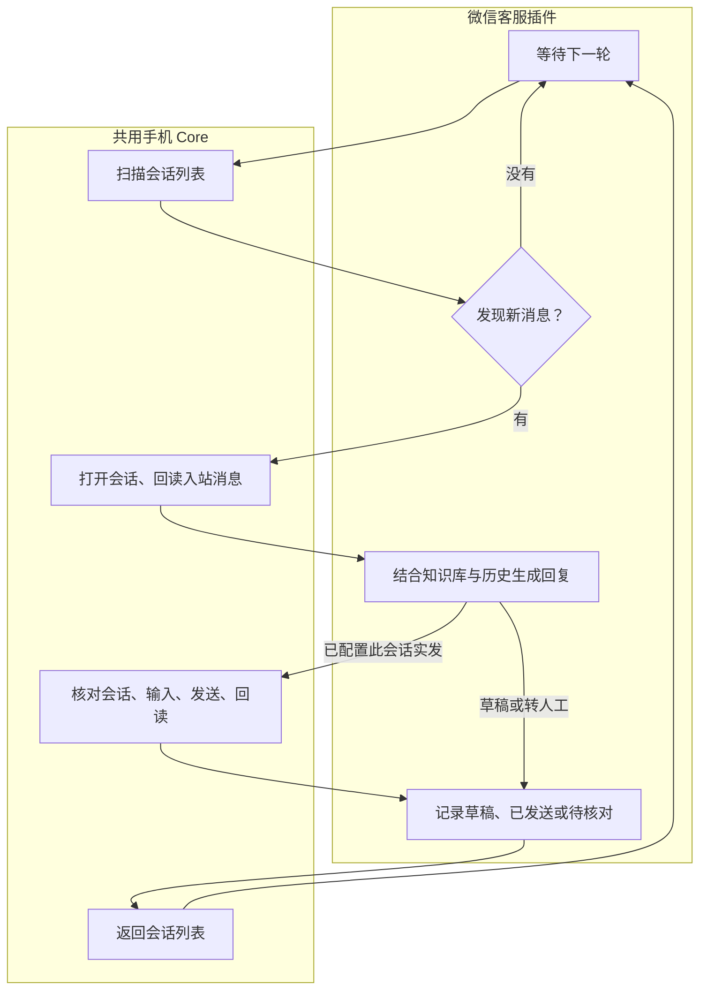

# 手机控制台使用说明

## macOS 手机控制台 App

在项目目录运行 `./desktop/build.sh`，然后打开 `dist/手机控制台.app`。需要本机可运行的 Python 3.10+ 和 Codex CLI。构建使用本机架构，部署目标为 macOS 14。

中控只使用官方 Codex CLI 的 ChatGPT 登录。首次使用可在终端运行 `codex login` 并选择 ChatGPT，然后在 App 内刷新状态。中控读取设备和任务状态，生成预览，经用户下发后启动已有脚本。看屏、点击、微信回复和短信处理仍由手机脚本执行。

用 USB 数据线连接 iPhone，App 会自动识别插入和拔出。首次使用请按手机提示完成信任，并通过 iPhone Use 准备手机控制。已准备过的手机可直接点「开启控制」，设备卡片会显示进度或失败原因。点可控制设备的画面打开实时预览窗口，可用加减按钮或触控板缩放。点设备名称旁的齿轮打开设置。每台手机有自己的任务和停止按钮。任务结果显示在底部，点击任务记录可查看输出。

「插件」面板可为当前手机选择通用任务的画面来源和点击方式。判断与执行组件可在设备设置里选择。微信客服、按名单发短信等任务插件可在面板中启停。

微信值守沿用原脚本的环境。如果密钥配置在终端环境中，从同一终端运行以下命令启动 App。

```sh
./dist/手机控制台.app/Contents/MacOS/PhoneConsole
```

本地插件描述文件是一个 JSON 对象，包含 `name`、`kind`、`entry` 和可选的 `detail`。`entry` 是 Python 的 `模块:函数`，模块可与描述文件放在同一目录。`kind` 可为 `task`、`screen-source`、`input-device`、`decision` 或 `loop`。任务插件接收 `--goal` 和 `--wda-state-dir`。设备插件契约见下方「接入插件」。

## Mac 本地控制台

在脚本目录启动控制台，然后打开 [手机 Agent 控制台](http://127.0.0.1:8767/)。

```sh
python3 phone_agent.py console --wda-state-dir "$HOME/.local/share/iphone-use-iphone12"
```

「运行任务」显示当前手机的 WDA 状态。选择「单次任务」后，可直接填写任务说明，或从任务模板选择「短信名单」，查看进度、准备草稿或发送。微信值守可以单独启动。运行记录显示任务状态和最近日志，刷新网页后可继续查看。

微信值守会继承启动控制台时的 `OPENAI_API_KEY`。切换手机时传入该设备对应的 `--wda-state-dir`。需要 iPhone 上的快捷指令访问时，另加 `--bind <Mac 的局域网 IP>`。

## 微信客服值守试验

`phone_agent.py watch` 启动常驻客服插件。插件检测新消息、结合知识库拟稿、记录处理结果和扫描进度。扫描会话列表、读取目标消息、发送回复及返回列表都通过 `phone_core.py` 的单次执行循环完成。每轮处理后释放设备锁，再等待下一轮。



两版共用 Mac 截图 OCR、本地知识库和 WDA。值守的 WDA 请求预算是 60 秒。无可见变化时只做本地扫描。测试会话的预览或 OCR 读到的未读数字变化后，Decisions / Luna 判断是否是新来信。

- `terra` 用 Responses API / GPT-6.1 Terra 判断能否打开目标会话，按 OCR 坐标定位。
- `decisions` 用 Decisions / Luna 从允许的动作中选择，按 OCR 坐标定位。

先准备已审核的知识库 JSON，格式为 `{"主题": "已审核的业务事实"}`。确保已授权的项目 Key 在当前进程的 `OPENAI_API_KEY` 中。真机测试时，先用 iPhone Use 启动对应 WDA，让手机保持竖屏、微信停在会话列表，并让指定测试联系人可见。用准确显示名替换以下占位值。

```sh
python3 phone_agent.py watch terra --contact '测试联系人' --knowledge /path/to/knowledge.json
python3 phone_agent.py watch decisions --contact '测试联系人' --knowledge /path/to/knowledge.json
```

同一台手机依次跑两版。双机并行时每个进程传不同的 `--wda-state-dir`。值守打开会话核对新来信，Terra 结合知识库、同一会话的最近来信和确认发出的回复生成答复、追问或转人工。记录按设备和会话保存在 Mac 的 `~/.local/share/iphone-use-desk/`，草稿不算已发回复。测试期间可用 `--send-to '测试联系人'` 为一个会话开启实发；其他会话只留草稿。发送前核对会话和输入栏，发送后回读新气泡。按 `Ctrl+C` 停止值守进程。

省略 `--contact` 可监控当前屏幕可见的会话。有变化时，模型只收到对应会话的一行裁图和用于判断的文字。处理完成后返回会话列表继续监控。

首次启动时记下可见会话的预览。此后重启会用保存的预览补扫当前可见会话，历史来信和已发回复从会话记录恢复。

## 单次任务与短信名单

```sh
python3 phone_agent.py once --goal '打开设置，读取 iOS 版本并返回结果' --wda-state-dir "$HOME/.local/share/iphone-use-iphone12"
```

自定义任务使用已登录的 Codex CLI 读取截图和选择操作，WDA 执行操作后获取新画面。短信名单中的每一行也进入同一个执行循环。短信的收件人、草稿及结果由「信息」App 的专用逻辑核对。

### 接入插件

`phone_core.py` 接收图源、输入设备和执行循环。自定义任务的决策函数可独立替换。`phone_agent.py once` 接受以下可选入口，入口格式为当前 Python 环境可导入的 `模块:函数`。

| 选项 | 插件契约 |
| --- | --- |
| `--screen-source` | 工厂返回上下文管理器，提供一个无参截图函数。每次返回当前设备画面的 Base64 PNG，裁去采集黑边。 |
| `--input-device` | 工厂返回上下文管理器，提供 `tap(x, y)`、`type_text(text)`、`swipe(direction)`、`home()`。点击坐标从画面左上角起，按宽和高归一化到 `0…1`。 |
| `--decision` | 函数接收 `frame, prompt, schema`，返回符合任务 schema 的动作字典。 |
| `--loop` | 函数接收 `observe, decide, before_effect`。每轮调用 `decide(observe())`。遇到 `Step` 执行动作，首次执行带 `commits` 的动作前调用传入的 `before_effect`，遇到完成结果时返回。 |

图源和输入设备同时指定后，自定义任务可以脱离 WDA 运行。同一部手机还在运行 WDA 任务时，可传相同的 `--wda-state-dir` 共用设备锁。微信和短信的现有模板仍使用 WDA 核对输入栏等原生界面信息。

新任务可提供 `main(argv)` 入口，通过 `python3 phone_agent.py plugin 模块:main <任务参数>` 启动，并复用 `phone_plugins.open_core` 来装配设备。下面是图源和输入插件的调用形式，模块名由实际接入的插件提供。

```sh
python3 phone_agent.py once --goal '打开设置，读取 iOS 版本' \
  --screen-source capture_plugin:open_screen --input-device input_plugin:open_input
```

CSV 需要 `task_id,phone,message` 三列，每行一个手机号和一条单行正文。保持同一批次的 CSV 路径和 `task_id`，重启时通过同目录的 `.sms.sqlite3` 读取进度。

```sh
python3 phone_agent.py sms /path/to/list.csv
python3 phone_agent.py sms /path/to/list.csv --draft --wda-state-dir "$HOME/.local/share/iphone-use-iphone12"
python3 phone_agent.py sms /path/to/list.csv --send --wda-state-dir "$HOME/.local/share/iphone-use-iphone12"
```

第一条列出进度，第二条在「信息」App 准备并核对下一条草稿，第三条发送尚未处理的记录。消息通道由「信息」App 根据设备和收件人选择。切页、失焦或发送结果异常时，脚本读取当前截图，使用本机 OCR 定位输入框，复杂画面交给已登录的 Codex CLI 判断。手机明确显示未送达且提供「作为短信发送」时，脚本使用该选项补发同一条并回读。单条仍无法确认时，记录状态并继续处理其余号码。

同一部手机上，微信值守每轮处理后释放设备锁。短信批次需要等待手机空闲，跑完切回微信会话列表，值守会继续补扫。

## 在网页配置触发器

启动控制台后，点顶部「触发器」，或直接打开 [触发器配置页](http://127.0.0.1:8767/triggers)。

在页面上新建规则，选择触发条件和执行任务，保存后点「启用」。触发条件支持每天定时、指定号码发来的苹果「信息」，以及快捷指令或脚本传来的事件。任务支持核对「信息」会话预览、记录指定 App 的可见文字、按 CSV 准备下一条短信草稿。填写 Mac 上的 UTF-8 CSV 文件路径。

规则保存在对应手机的本地数据库中，编辑和启停即时生效。停用会暂停已入队但尚未开始的事件，启用后继续。正在执行的任务会收尾。已入队的事件沿用入队时的动作。定时规则使用 Mac 的本地时间，需要接收端在触发时间运行。

### 从 iPhone 或脚本触发

从 iPhone 触发时，启动命令加上 `--bind <Mac 的局域网 IP>`。配置页仍只在 Mac 上打开。保存规则后，在页面复制事件地址和访问令牌。在 iPhone「快捷指令」里选可用的触发条件，并通过「获取 URL 内容」发送 POST。请求头填 `Authorization: Bearer <访问令牌>`，正文选择 JSON 并填 `event_id`，例如 `20261110T224500123`。使用「苹果信息」规则时，再传 `sender`，填写对应发件人手机号。重试同一个事件时复用 ID。

旧命令 `--config /path/to/triggers.json` 仍可运行原来的静态规则。使用该命令时，相对 CSV 路径以规则文件所在目录为准，并继续使用 `PHONE_TRIGGER_TOKEN`。

### 苹果「信息」来信简写

在 Mac 终端设置 `PHONE_TRIGGER_TOKEN`，再启动接收端。将命令里的号码和 IP 改成测试发件人的手机号和 Mac 的局域网 IP。

```sh
python3 phone_agent.py trigger --sender '+12025550147' --bind 192.168.1.10 \
  --wda-state-dir "$HOME/.local/share/iphone-use-iphone12"
```

在 iPhone「快捷指令」中建立「信息」个人自动化，选同一个测试发件人并设为自动运行。通过「获取 URL 内容」向 `http://192.168.1.10:8766/events/messages` 发 POST。请求头 `Authorization` 填 `Bearer <PHONE_TRIGGER_TOKEN 的值>`，正文类型选 JSON，传入 `event_id`，例如 `{"event_id":"20261110T224500123"}`。每次来信使用唯一 ID，同一个事件重试时复用 ID。

Mac 先记录事件，再等设备空闲且手机解锁。首版核对发件人号码对应的可见会话预览，结果存在 `~/.local/share/iphone-use-desk/` 的 `*-trigger.sqlite3`。同 ID 的请求只入队一次。预览记录后切回原 App。切回失败时，下次接着恢复原 App，微信值守从保存的进度补扫。

离线检查使用 `python3 -m unittest -v test_wechat_desk.py test_sms_batch.py test_phone_plugins.py test_phone_trigger.py test_trigger_settings.py test_phone_console.py`。
