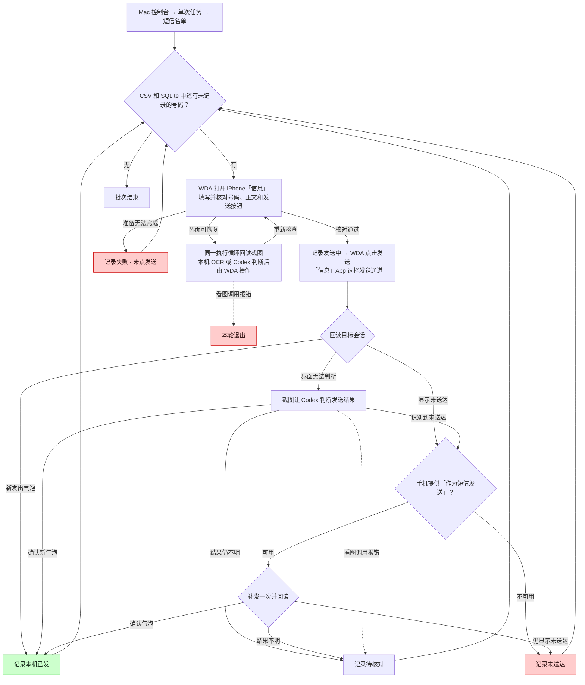

# iPhone 短信批次流程

- 每条记录写入与 CSV 同名的 `.sms.sqlite3`。同一名单重启时，已入账的任务会显示已有状态并跳过。上次停在「发送中」的条目在输出中显示为「待核对」。
- 「本机已发」依据手机屏幕上的发出气泡。收件端的送达状态未在这条链路中验证。
- 单条准备失败、未送达或结果不明后继续下一条。发送前的 Codex 看图调用报错时退出，发送后的看图报错会记为「待核对」。

## 代码依据

- 控制台入口和子进程管理见 `phone_console.py:PhoneConsole.arguments`、`PhoneConsole.start` 与 `PhoneConsole.stop`。
- 批次入口、SQLite 状态和续跑见 `sms_batch.py:main` 与 `run_batch`，使用 `outcomes` 表的 `id`、`fingerprint`、`status`、`reason` 字段。
- 自定义任务、每条短信和微信手机任务均由 `phone_core.py:execute_once` 调用各自的画面判断和操作。
- 界面准备和纠错见 `messages_task.py:MessagesApp.execute` 与 `prepare_once`。
- 屏幕判定和短信补发见 `messages_task.py:MessagesApp.confirm_send`、`sent_on_screen`、`open_delivery_options` 与 `retry_delivery`。
- 本机 OCR 和 Codex CLI 看图见 `sms_vision.py:local_composer` 与 `decide`。CLI 调用未指定模型名称。
